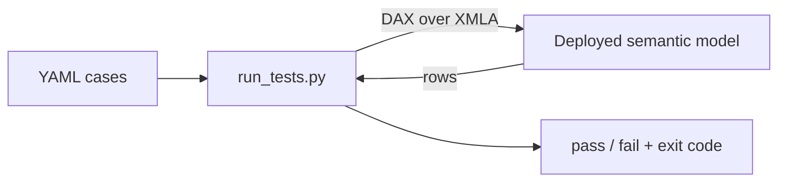
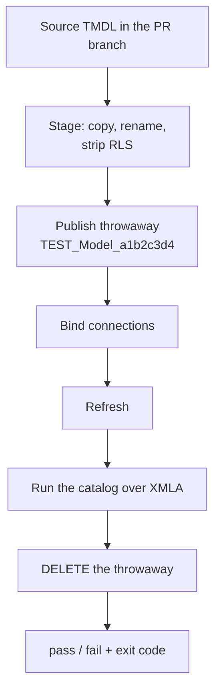

## Introduction

Our team is constantly making changes to our semantic models (adding new measures, renaming columns, adding tables, etc.). Just because the changes still result in a valid schema and refreshes are still successful, it doesn't tell you that our queries still return the expected results.

I wanted a way to write some DAX, define what the result should look like, and fail the build/deployment if it doesn't match expectations.

In this post, I'll walk through how we accomplished this. I'll start with the tester  and then show how we use it in our pull requests, where each PR publishes a temporary copy of the model, tests it, and then deletes it. You can find the code here: [GitHub](https://github.com/DAXNoobJustin/daxnoob.blog/tree/main/resources/semantic-model-tests).

<!-- more -->

## Part 1: the tester

The tester is a small Python command line tool that takes a folder of YAML test cases and runs the DAX for each case over the XMLA endpoint and prints a pass/fail summary. There are three types of assertions:

- **structural**: checks the *shape* of the result (row count, columns, or whether a value is present).
- **negative**: the query *must* fail, and the error must match a regex. For example, does a bad reference return the error you expect?
- **snapshot**: saves the exact result to a file the first time it runs, then fails if the result ever changes. This is useful for locking in the output of a calculation.

```yaml
cases:
  - id: measure_resolves
    category: structural
    dax: "EVALUATE { [Total Amount] }"
    expected_row_count: { exact: 1 }

  - id: bad_measure_errors
    category: negative
    dax: "EVALUATE { [No Such Measure] }"
    expected_error_regex: "cannot be determined|not a valid|no such"

  - id: amount_by_category      # snapshot - baseline captured with --update-snapshots
    category: snapshot
    dax: "EVALUATE SUMMARIZECOLUMNS ( Product[Category], \"Amount\", [Total Amount] ) ORDER BY Product[Category]"
```

That's really all there is to it. You have a folder of these test cases, you run them in your pipeline, and the build fails if one of them breaks.



The tool exits with `0` if everything passes, `1` if an assertion fails, or `2` if the tool itself couldn't run (bad login, can't reach the model, etc.).

!!! warning "Snapshots include your data"
    A snapshot compares the result of the model *and* the data, so a normal data refresh can change it too. Point your snapshots at stable test data so a failed build means something actually broke, not that yesterday's numbers changed.

!!! note "Requirements"
    - **Windows only.** Queries run over XMLA using the AdomdClient .NET library, which requires .NET Framework. It's downloaded from NuGet the first time you run the tool.
    - **Auth.** A regular `az login` token gets rejected by the XMLA endpoint, so use `--interactive-auth` when running locally. Service principals work as-is.

## Part 2: a disposable model per pull request

Everything above assumes you already have a deployed model to test. That works, but there's a gap. You're testing *a* model, not necessarily *the change* in your PR. Someone has to remember to deploy the branch first, and if they don't, the build passes against last week's model.

So in our pipelines, we use `--deploy-from`. Instead of pointing at a deployed model, you point it at the `*.SemanticModel/` folder in your repo:



Here's what each step does:

**Stage.** Copies the TMDL to a temp folder and changes the `displayName` in `.platform`. The rename is important. fabric-cicd matches existing items by **type + display name**, so a new name creates a second model instead of overwriting your real one. It also removes `definition/roles/`, since the service principal isn't a member of any RLS role.

**Publish.** Uses [fabric-cicd](https://github.com/microsoft/fabric-cicd) with `unpublish.skip: true`. This setting is really important. By default, fabric-cicd removes anything in the workspace that isn't in your source folder, and in this case your source folder only has the one staged model. Without it, you'd delete everything else in the workspace.

**Bind.** A newly published DirectLake model doesn't have any connections bound to it, so the refresh fails until you add them. The tool binds an existing connection. It doesn't create one. You need to set up the connection in Fabric ahead of time and give the identity running the tests `Use` permission on it. You don't need read access on the upstream workspace. The refresh runs under the connection's identity, which is how a temporary model in a dev workspace can still refresh against prod data.

**Delete.** Runs in a `finally` block, so the temporary model gets deleted even if an assertion fails or the publish errors out. If the model id was never captured, it looks the model up by name before giving up. If the pipeline gets killed, the `finally` block won't run, so if you're running this a lot, it's a good idea to schedule a cleanup job for leftover `TEST_*` models.

!!! danger "📸 SCREENSHOT PLACEHOLDER — the throwaway model in the workspace"
    The workspace item list mid-run, showing `TEST_<Model>_<hex>` next to the
    real model, then the same list after teardown. Replace with:
    ``

### DirectLake vs. Import

Whether this works well for you mostly depends on your storage mode.

**DirectLake** doesn't load data into the model. It reads directly from the lakehouse. So the temporary model doesn't have anything to process, and a `Calculate` refresh finishes in a few seconds. That's why we're able to do this on a large enterprise model for every pull request.

**Import** is different. The copy has to load all of its data before any data assertion can run, and a `Full` refresh can take anywhere from a few minutes to tens of minutes. If you do that on every PR, people will start ignoring the check. If you're using Import, I'd stick with Part 1 and keep your PR tests to metadata and shape checks (does the measure resolve, does the query run, does a bad reference still error, etc.). None of those need data loaded.

There's another benefit to refreshing the temporary model. It proves that the connections bind, the credentials work, and the upstream schema still matches. If someone renamed a lakehouse column, the refresh fails in the PR instead of in tomorrow's scheduled refresh. Keep in mind that a successful refresh doesn't mean there's data, since an empty table refreshes just fine. If you want to check for that, add an assertion:

```yaml
  - id: sales_has_rows
    category: structural
    dax: "EVALUATE ROW ( \"n\", COUNTROWS ( Sales ) )"
    contains_none: ["n: 0"]
```

## What else is out there

There aren't many tools for testing semantic model query results in a pipeline, but here are a few others worth checking out:

- **[Tabular Editor's Best Practice Analyzer](https://docs.tabulareditor.com/)** checks the model *definition* for things like naming, missing keys, and anti-patterns. It works well alongside this tool since it checks the structure, not what a query returns.
- **[semantic-link-labs / sempy](https://github.com/microsoft/semantic-link-labs)** has `evaluate_dax()` in Python, which is great for ad-hoc validation in a Fabric notebook.
- **[John Kerski's `Invoke-DQVTesting`](https://github.com/kerski/fabric-dataops-patterns)** is the most similar. It also runs DAX over XMLA in a pipeline, but it's written in PowerShell and the tests live inside the PBIP project.

The main differences with this tool are that the tests live in separate YAML files, it supports snapshot and negative tests, and it can deploy and delete the model it's testing.

## Trying it

`examples/sample.yml` has an example of each assertion type. Copy it and swap in your own DAX. There are also pipeline templates in `ci/` for both modes.

```powershell
pip install -r requirements.txt
az login   # or add --interactive-auth to the commands below

# Part 1: test a model you've already deployed.
# Capture the snapshot baseline once, review the sidecar, commit it:
python run_tests.py --workspace-id <ws-guid> --model "Your Model" `
    --catalog-dir tests --update-snapshots

python run_tests.py --workspace-id <ws-guid> --model "Your Model" `
    --catalog-dir tests

# Part 2: publish a throwaway from the TMDL in your branch, test it, delete it.
python run_tests.py --workspace-id <ws-guid> `
    --deploy-from "MODELS/Your Model.SemanticModel" `
    --connection-id <connection-guid> `
    --catalog-dir tests
```

Here is what a Part 2 run looks like:

```terminal
==> Source:     MODELS/Your Model.SemanticModel
==> Throwaway:  TEST_YourModel_530c9cee
==> Workspace:  11111111-2222-3333-4444-555555555555
==> Cases:      4 from 1 dir(s)
==> Publishing throwaway
==> Model id:   aaaaaaaa-bbbb-cccc-dddd-eeeeeeeeeeee
    Refreshing (Full/transactional, poll timeout 1200s)
==> Refresh complete in 5.1s
==> Running 4 case(s) via AdomdClient (XMLA)
==> AdomdClient XMLA batch: 4 queries
==> All queries complete in 4.9s
==> Teardown:   deleted

================================================================================
  4 run, 4 passed, 0 failed
================================================================================
  [PASS] structural  order_count_resolves
  [PASS] structural  product_categories_present
  [PASS] negative    missing_measure_errors
  [PASS] snapshot    total_amount_by_category
```

The whole thing (deploy, refresh, four assertions, and teardown) took about 25 seconds. When a snapshot changes, you get the diff:

```terminal
  [FAIL] snapshot    total_amount_by_category
           snapshot mismatch:
           --- expected
           +++ actual
           -[{"Product[Category]": "Hardware", "[Total Amount]": 9999}, ...
           +[{"Product[Category]": "Hardware", "[Total Amount]": 9000}, ...
```

!!! danger "📸 SCREENSHOT PLACEHOLDER — a red PR build"
    The Azure DevOps PR page with the check failed, and the log showing the
    snapshot mismatch. Replace with:
    ``

The [README](https://github.com/DAXNoobJustin/daxnoob.blog/tree/main/resources/semantic-model-tests) has all of the parameters, the auth details, and the permissions each mode needs (Viewer for Part 1, Contributor for Part 2 since it creates and deletes items).

## Conclusion

You don't need a big framework to test your semantic models. You just need a way to run some DAX, check the result, and add it to your pipeline. With a few YAML files, you can check that your measures resolve, your values make sense, your errors behave the way you expect, and (with snapshots) that a calculation still returns the same result.

If you're using DirectLake, I'd recommend letting your pipeline deploy and delete the model for you. That way you're testing the exact model in your branch, and you don't have to worry about "it worked in dev."

The full source code is on [GitHub](https://github.com/DAXNoobJustin/daxnoob.blog/tree/main/resources/semantic-model-tests). I hope you find it helpful.

Like always, if you have any questions or feedback, please reach out. I'd love to hear from you!
