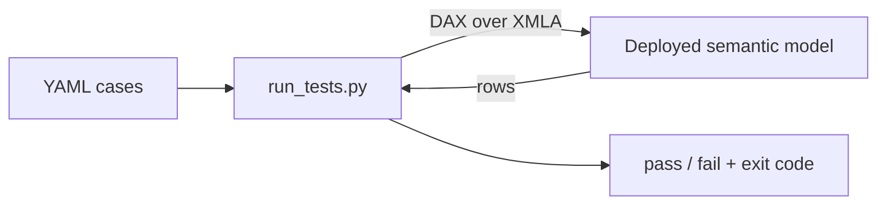
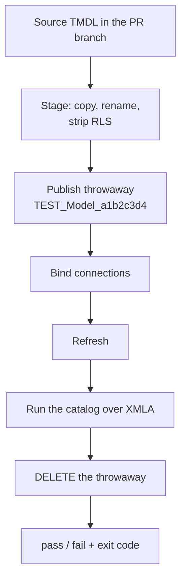

## Introduction

We ship changes to semantic models constantly - a new measure, a renamed column, a tweaked filter, a refactored calculation group. Any one of those can quietly break something downstream, and a semantic model has no equivalent of "run the unit tests." A refresh that *succeeds* only tells you the model loaded - not that `[Total Revenue]` still returns the number it did yesterday.

What I wanted was boring and obvious: **write some DAX, say what the result should look like, and fail the build if it doesn't.** So I built a small tool that does exactly that and open-sourced it. It works against any semantic model you can reach over XMLA, and it's on [GitHub](https://github.com/DAXNoobJustin/daxnoob.blog/tree/main/resources/semantic-model-tests), MIT licensed.

This post has two halves: the tester itself, and then how we actually use it - every pull request publishes a disposable copy of the model, tests it, and deletes it.

<!-- more -->

## Part 1: the tester

A tiny Python CLI. You give it a folder of YAML test cases and point it at a deployed model; it runs each case's DAX over the XMLA endpoint and prints a pass/fail summary. There are three kinds of assertion:

- **structural** - assert on the *shape* of the result (row count, columns, a value is present).
- **negative** - the query *must* fail, and the error must match a regex (does a bad reference error correctly?).
- **snapshot** - capture the exact result once into a sidecar file, then fail on any drift (great for locking a calculation's output).

!!! danger "📸 SCREENSHOT PLACEHOLDER — the YAML catalog in an editor"
    A catalog file open in VS Code showing a few real cases, so readers can see
    the shape before reading the abridged sample below. Delete this admonition
    and replace with:
    ``

```yaml
cases:
  - id: measure_resolves
    category: structural
    dax: "EVALUATE { [Total Amount] }"
    expected_row_count: { exact: 1 }

  - id: bad_measure_errors
    category: negative
    dax: "EVALUATE { [No Such Measure] }"
    expected_error_regex: "cannot be determined|not a valid|no such"

  - id: amount_by_category      # snapshot - baseline captured with --update-snapshots
    category: snapshot
    dax: "EVALUATE SUMMARIZECOLUMNS ( Product[Category], \"Amount\", [Total Amount] ) ORDER BY Product[Category]"
```

That's the whole mental model: a folder of these, run in CI, red build if a contract breaks.



The runner exits `0` (all pass), `1` (an assertion failed), or `2` (the harness itself couldn't run - bad login, can't reach the model). That 1-vs-2 split matters in CI: it tells "a test failed" apart from "the pipeline broke."

One thing to be honest about: a snapshot compares the combined model-and-data result, so a legitimate data refresh can change it too. Point snapshots at stable test data so a red build means a real regression, not yesterday's numbers moving.

## Why XMLA (and not the REST API)

Each query runs over the XMLA endpoint via the AdomdClient .NET assembly, loaded in-process with [pythonnet](https://github.com/pythonnet/pythonnet). That's deliberate: **XMLA isn't gated by the "Dataset Execute Queries REST API" tenant setting**, so it keeps working for a service principal in CI, where the REST path is often rejected. The assembly comes from NuGet on first run and is cached - nothing binary lives in the repo.

Two catches. AdomdClient's `net45` build wants .NET Framework, so this is a Windows tool - which suits a semantic-model CI already running on Windows agents. And XMLA only accepts user tokens from a *Power BI-registered* client, so a plain `az login` token gets refused at connect time; `--interactive-auth` handles that locally, and service principals are already approved.

## Part 2: a disposable model per pull request

Everything above assumes you already have a model deployed to point at. That works, but it has an awkward gap: you're testing *a* model, not necessarily *the change*. Somebody has to remember to deploy the branch first, and if they don't, you get a green build that validated last week's model.

So the mode we actually run in CI is `--deploy-from`. Instead of naming a deployed model, you hand it the `*.SemanticModel/` directory in the repo:



Here are the steps that are worth a closer look:

**Stage.** Copy the TMDL to a temp dir and rewrite `displayName` in `.platform`. That rename is the load-bearing part: fabric-cicd matches an already-deployed item by **type + display name**, so a new name is what creates a second item instead of overwriting your source. It also strips `definition/roles/`, since the service principal isn't a member of any RLS role.

**Publish.** Straight [fabric-cicd](https://github.com/microsoft/fabric-cicd), with one setting that matters a lot: `unpublish.skip: true`. Its default is to treat anything in the workspace that isn't in your source directory as an orphan and remove it - and your source directory holds exactly one staged model. Leave that off at your peril.

**Bind.** A freshly published DirectLake model has no bound connections, so the refresh fails until you attach them. Note that the tool binds an existing connection - it doesn't create one. You need the connection object already set up in Fabric, and the identity running the tests needs `Use` permission on it. That's a smaller grant than it sounds: `Use` on the connection is enough, with no read access on the upstream workspace. Refresh then flows through the connection's own identity, which is why a throwaway in a dev workspace can still refresh against prod data.

**Delete.** In a `finally`, and if the id was never captured the runner re-resolves by the unique name before giving up - so a failed assertion or a mid-publish error still tears down. A hard kill can't honour a `finally`, so at scale, pair it with a scheduled sweep for stray `TEST_*` models.

!!! danger "📸 SCREENSHOT PLACEHOLDER — the throwaway model in the workspace"
    The workspace item list mid-run, showing `TEST_<Model>_<hex>` sitting next to
    the real model, then the same list after teardown. Two side-by-side shots
    sell the "it's gone" half better than prose can. Replace with:
    ``

### Why this is practical (and when it isn't)

Storage mode decides everything here, and it's the honest reason the pattern works for us.

**DirectLake** doesn't load data into the model - it reads live from the lakehouse. So the throwaway has nothing to process and a `Calculate` refresh comes back in seconds. That's what makes deploy-test-destroy viable on a real enterprise model, per pull request.

**Import** is a different story. The copy has to load its data before a single data assertion can run, and a cold `Full` refresh is minutes to tens of minutes. Do that on every PR and your team will (correctly) start ignoring the gate. If you're on Import, stay with Part 1 and keep the per-PR suite to metadata and shape assertions - does the measure resolve, does the query compile, does a bad reference still error - none of which need loaded data.

There's a bonus in the refresh itself. A throwaway that has to actually refresh proves things a metadata diff never will: the connections bind, the credentials work, and the upstream schema still matches. A renamed lakehouse column that would break tomorrow's refresh breaks *this* one, in the PR. Just don't over-read it - a refresh succeeding doesn't mean the data is there, since an empty table refreshes perfectly happily. If you want to gate on that, assert it:

```yaml
  - id: sales_has_rows
    category: structural
    dax: "EVALUATE ROW ( \"n\", COUNTROWS ( Sales ) )"
    contains_none: ["n: 0"]
```

## What else is out there

Testing a semantic model's *query results* from CI is a sparse space, but there are a few neighbors worth knowing:

- **[Tabular Editor's Best Practice Analyzer](https://docs.tabulareditor.com/)** lints the model *definition* - naming, missing keys, anti-patterns. Complementary rather than competing: it checks structure, not what a query returns.
- **[semantic-link-labs / sempy](https://github.com/microsoft/semantic-link-labs)** gives you `evaluate_dax()` in Python, and it's excellent for ad-hoc validation inside a Fabric notebook.
- **[John Kerski's `Invoke-DQVTesting`](https://github.com/kerski/fabric-dataops-patterns)** is closest in spirit - also DAX over XMLA in CI, in PowerShell, with the tests living inside the PBIP project.

What's different here is the combination: assertions in external YAML, snapshot and negative cases as first-class citizens, and the ability to stand up and tear down the model it tests.

## Trying it

`examples/sample.yml` has one worked example of each assertion category - copy it and swap in your own DAX. There are anonymized CI templates in `ci/` for both modes.

```powershell
pip install -r requirements.txt
az login   # or add --interactive-auth to the commands below

# Part 1: test a model you've already deployed.
# Capture the snapshot baseline once, review the sidecar, commit it:
python run_tests.py --workspace-id <ws-guid> --model "Your Model" `
    --catalog-dir tests --update-snapshots

python run_tests.py --workspace-id <ws-guid> --model "Your Model" `
    --catalog-dir tests

# Part 2: publish a throwaway from the TMDL in your branch, test it, delete it.
python run_tests.py --workspace-id <ws-guid> `
    --deploy-from "MODELS/Your Model.SemanticModel" `
    --connection-id <connection-guid> `
    --catalog-dir tests
```

Here is what a Part 2 run looks like end to end:

```terminal
==> Source:     MODELS/Your Model.SemanticModel
==> Throwaway:  TEST_YourModel_530c9cee
==> Workspace:  11111111-2222-3333-4444-555555555555
==> Cases:      4 from 1 dir(s)
==> Publishing throwaway
==> Model id:   aaaaaaaa-bbbb-cccc-dddd-eeeeeeeeeeee
    Refreshing (Full/transactional, poll timeout 1200s)
==> Refresh complete in 5.1s
==> Running 4 case(s) via AdomdClient (XMLA)
==> AdomdClient XMLA batch: 4 queries
==> All queries complete in 4.9s
==> Teardown:   deleted

================================================================================
  4 run, 4 passed, 0 failed
================================================================================
  [PASS] structural  order_count_resolves                     (0.00s)
  [PASS] structural  product_categories_present               (0.00s)
  [PASS] negative    missing_measure_errors                   (0.00s)
  [PASS] snapshot    total_amount_by_category                 (0.00s)
```

Deploy, refresh, four assertions and teardown - about 25 seconds. And when a snapshot drifts, you get the diff:

```terminal
  [FAIL] snapshot    total_amount_by_category                 (0.00s)
           snapshot mismatch:
           --- expected
           +++ actual
           -[{"Product[Category]": "Hardware", "[Total Amount]": 9999}, ...
           +[{"Product[Category]": "Hardware", "[Total Amount]": 9000}, ...
```

!!! danger "📸 SCREENSHOT PLACEHOLDER — a red PR build"
    The payoff shot: the Azure DevOps PR page with the check failed, and the log
    showing the snapshot mismatch. This is the one image that explains why any of
    this matters, so it's worth getting right. Replace with:
    ``

The [README](https://github.com/DAXNoobJustin/daxnoob.blog/tree/main/resources/semantic-model-tests) has the full flag reference, the auth gotchas, and the permissions each mode needs (Viewer for Part 1; Contributor for Part 2, since it creates and deletes items).

## Conclusion

You don't need a heavyweight framework to get real confidence in a semantic model - you need a way to say "run this DAX, expect this" and wire it into CI. Plain YAML over XMLA covers a surprising amount of ground: measure contracts, value sanity, error handling, and - via snapshots - the exact output of a calculation.

If you're on DirectLake, go the extra step and let CI stand the model up and tear it down for you. Testing the exact artifact your branch produces removes a whole category of "well, it worked in dev."

The full source code is on [GitHub](https://github.com/DAXNoobJustin/daxnoob.blog/tree/main/resources/semantic-model-tests). I hope you find it helpful.

Like always, if you have any questions or feedback, please reach out. I'd love to hear from you!
