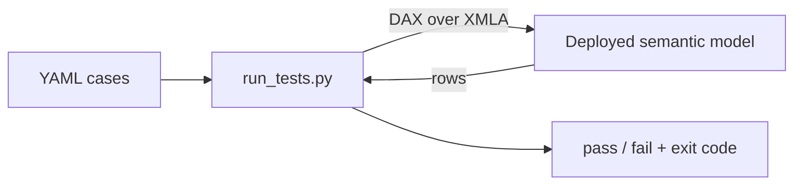

## The problem

We ship changes to semantic models constantly - a new measure, a renamed column, a tweaked filter, a refactored calculation group. Any one of those can quietly break something downstream, and a semantic model has no equivalent of "run the unit tests." A refresh that *succeeds* only tells you the model loaded - not that `[Total Revenue]` still returns the number it did yesterday.

What I wanted was boring and obvious: **write some DAX, say what the result should look like, and fail the build if it doesn't.** So I built a small tool that does exactly that and open-sourced it. It's model-agnostic - it works against any semantic model you can reach over XMLA - and it's on [GitHub](https://github.com/DAXNoobJustin/daxnoob.blog/tree/main/resources/semantic-model-tests), MIT licensed.

<!-- more -->

## What it is

A tiny Python CLI. You give it a folder of YAML **test cases** and point it at a deployed model; it runs each case's DAX over the **XMLA endpoint** and prints a pass/fail summary. There are three kinds of assertion:

- **structural** - assert on the *shape* of the result (row count, columns, a value is present).
- **negative** - the query *must* fail, and the error must match a regex (does a bad reference error correctly?).
- **snapshot** - capture the exact result once into a sidecar file, then fail on any drift (great for locking a calculation's output).

```yaml
cases:
  - id: measure_resolves
    category: structural
    dax: "EVALUATE { [Total Amount] }"
    expected_row_count: { exact: 1 }

  - id: bad_measure_errors
    category: negative
    dax: "EVALUATE { [No Such Measure] }"
    expected_error_regex: "cannot be determined|not a valid|no such"

  - id: amount_by_category      # snapshot - baseline captured with --update-snapshots
    category: snapshot
    dax: "EVALUATE SUMMARIZECOLUMNS ( Product[Category], \"Amount\", [Total Amount] ) ORDER BY Product[Category]"
```

That's the whole mental model: a folder of these, run in CI, red build if a contract breaks.



The runner exits `0` (all pass), `1` (an assertion failed), or `2` (the harness itself couldn't run - bad login, can't reach the model). That 1-vs-2 split matters in CI: it tells "a test failed" apart from "the pipeline broke."

One thing to be honest about up front: a snapshot compares the **combined model-and-data** result, so a legitimate data refresh can change it too. Point snapshots at stable test data (or a fixed historical slice) so a red build means a real regression, not yesterday's numbers moving.

## Why XMLA (and not the REST API)

Each query runs over the **XMLA endpoint** via the AdomdClient .NET assembly, loaded in-process with [pythonnet](https://github.com/pythonnet/pythonnet). That's a deliberate choice over the `executeQueries` REST API: **XMLA isn't gated by the "Dataset Execute Queries REST API" tenant setting**, so it keeps working for a **service principal** in CI, where the REST path is often rejected. The assembly is pulled from NuGet on first run and cached - nothing binary lives in the repo.

The catch: AdomdClient's `net45` build wants **.NET Framework**, so this is a Windows tool - which suits a semantic-model CI that already runs on Windows agents. (One auth wrinkle worth knowing: the XMLA endpoint only accepts user tokens from a *Power BI-registered* client, so a plain `az login` token can be refused at connect time - the tool's `--interactive-auth` handles that, and service principals are already approved. The README has the details.)

## The honest caveat: Import models and the refresh wall

This tool tests a model that's **already deployed and refreshed** - it doesn't deploy or refresh anything itself. That's on purpose, and it's the thing to be clear-eyed about.

A freshly deployed, metadata-only copy of a large **Import** model has to be processed before any data assertion can run, and a full refresh of a real enterprise model can take **many minutes**. So a throwaway-copy-per-PR pattern - deploy, refresh, test, all on every run - gets painfully slow for Import. (DirectLake shifts the cost: it reads live from the lakehouse, so there's no data load to pay on the model itself.)

So the practical pattern for Import is:

- **Data assertions** ("revenue is positive", "the Fabric product exists") - point the tool at a long-lived model you already deployed and refreshed once (your dev model), so the expensive refresh happens on *your* schedule, not per test run.
- **Metadata / shape / error assertions** (does the measure resolve? does the query compile? does a bad reference error?) - these don't depend on current business data, so they're cheap against any deployed model.

It's not a full data-pipeline test harness, and it doesn't try to be. It's a fast way to assert the *contracts* of a model.

## What else is out there

Testing a semantic model's *query results* from CI is a surprisingly sparse space, so it's worth being fair about the neighbors:

- **[Tabular Editor's Best Practice Analyzer](https://docs.tabulareditor.com/)** lints the model *definition* (naming, missing keys, anti-patterns). It's great, and complementary - but it checks structure, not what a query returns.
- **[semantic-link-labs / sempy](https://github.com/microsoft/semantic-link-labs)** gives you `evaluate_dax()` in Python and shines for ad-hoc validation *inside a Fabric notebook* - but it's notebook-first, not a standalone CI runner.
- **[John Kerski's `Invoke-DQVTesting`](https://github.com/kerski/fabric-dataops-patterns)** is the closest in spirit: it also runs DAX over XMLA in CI, but it's PowerShell and expects the tests to live *inside* the PBIP project as specially-formatted DAX.

What's different here is a small combination: assertions live in **external YAML** (drop the folder next to any deployed model), it runs over **XMLA** (so SP-in-CI works), and it treats **snapshot** and **negative** cases as first-class. Nothing revolutionary - just a focused CI runner for the gap between "the model refreshed" and "the numbers are still right."

## Trying it

The repo ships a tiny, self-contained **sample model** (`examples/sample-model/`) - an Import model that generates its own 240 rows in Power Query, so you can deploy it, capture a snapshot, and watch a green run without wiring up any data. There are also anonymized **CI templates** for Azure DevOps and GitHub Actions in `ci/`.

```powershell
pip install -r requirements.txt
az login   # or add --interactive-auth to the commands below

# Once, after deploying + refreshing the sample: capture the snapshot baseline
python run_tests.py --workspace-id <ws-guid> --model "Sales Sample" `
    --catalog-dir examples/sample-model/tests --update-snapshots

# Then run the suite
python run_tests.py --workspace-id <ws-guid> --model "Sales Sample" `
    --catalog-dir examples/sample-model/tests
```

The [sample walkthrough](https://github.com/DAXNoobJustin/daxnoob.blog/tree/main/resources/semantic-model-tests/examples/sample-model) has the full step-by-step.

## Wrapping up

You don't need a heavyweight framework to get real confidence in a semantic model - you need a way to say "run this DAX, expect this" and wire it into CI. In practice that means deploying the candidate model to a test workspace, running these assertions against it, and gating promotion to production on a green result - so a change that quietly breaks a number can't ride through. Keeping the assertions in plain YAML and running them over XMLA covers a surprising amount of ground: measure contracts, value sanity, error handling, and - via snapshots - the exact output of a calculation.

Just go in clear-eyed about the Import refresh wall, and lean on an already-refreshed model for anything that needs loaded data.

Code's on [GitHub](https://github.com/DAXNoobJustin/daxnoob.blog/tree/main/resources/semantic-model-tests) - point it at your own model and let me know what you catch with it.
